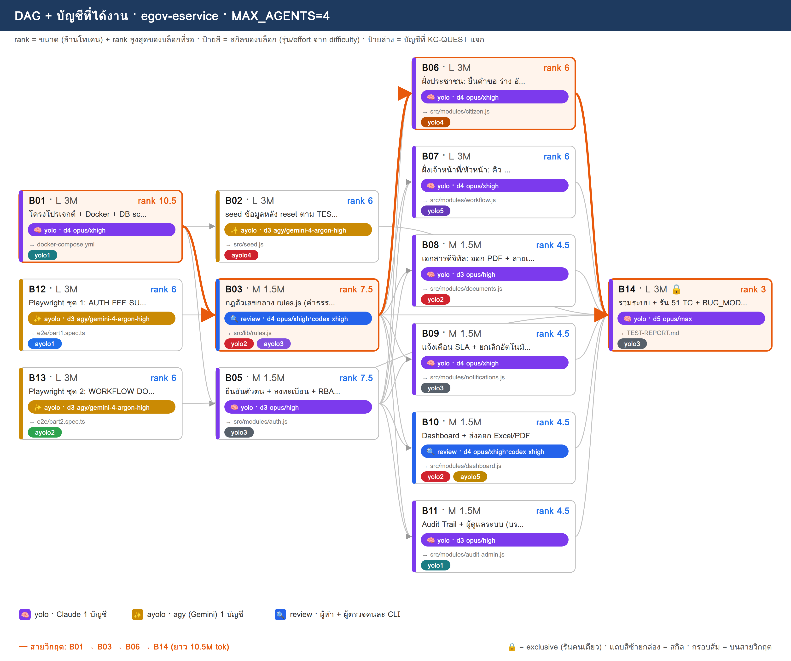
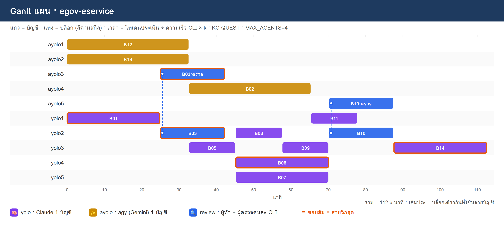

# PLAN · egov-eservice

**โจทย์:** สร้างเว็บ e-Service กลางตามชุดโจทย์ใน /workspace/egov-brief (อ่าน README.md ก่อน) ทำตาม REQUIREMENTS.md CONTRACT.md TEST-DATA.md DECISIONS.md ครบทุกข้อ รันด้วย Docker Compose คำสั่งเดียว รองรับ TEST_MODE=1 และ BUG_MODE ตาม BUGS.md และมีชุด Playwright ครบทุก TC ใน TEST-PLAN.md · stack: Node.js 20 + Express + better-sqlite3 (DB_PATH) + หน้าเว็บ render ฝั่งเซิร์ฟเวอร์ · โมดูลอยู่ใน app/src/modules/*.js ซึ่ง server.js โหลดอัตโนมัติ · กฎตัวเลขทั้งหมดเรียกผ่าน app/src/lib/rules.js · เวลาอ่านจาก app/src/lib/clock.js เท่านั้น · บั๊ก BUG_MODE ใส่ในโมดูลที่เป็นเจ้าของกฎนั้นผ่าน isBug('Bxx') จาก app/src/lib/bugmode.js

วางแผนเมื่อ 23/11/2026 18:30 · MAX_AGENTS 4 · บัญชี ayolo1, ayolo2, ayolo3, ayolo4, ayolo5, yolo1, yolo2, yolo3, yolo4, yolo5 · ตัวปรับเวลา k (ยังไม่มี calib.json → k=1)

> แผนนี้ยังไม่ได้รันจริง — KC-QUEST เลือกบัญชีจากโควตา แล้วจำลองเวลาตาม dependency

## 1) โควตาของแต่ละบัญชี

| บัญชี | แพลน | ใช้ไป 5 ชม. | ใช้ไปสัปดาห์ | headroom | รีเซ็ต/หมดอายุ (ชม.) | U | slot | ที่มา |
|---|---|---|---|---|---|---|---|---|
| ayolo1 | default | 0% | 0% | **100%** | 168.0 | 0.125 | 3 | team.py quota |
| ayolo2 | default | 0% | 0% | **100%** | 168.0 | 0.125 | 3 | team.py quota |
| ayolo3 | default | 0% | 0% | **100%** | 168.0 | 0.125 | 3 | team.py quota |
| ayolo4 | default | 0% | 0% | **100%** | 168.0 | 0.125 | 3 | team.py quota |
| ayolo5 | default | 0% | 0% | **100%** | 168.0 | 0.125 | 3 | team.py quota |
| yolo1 | default | 55% | 17% | **45%** | 139.5 | 0.147 | 3 | team.py quota |
| yolo2 | default | 55% | 17% | **45%** | 139.5 | 0.147 | 3 | team.py quota |
| yolo3 | default | 55% | 17% | **45%** | 139.5 | 0.147 | 3 | team.py quota |
| yolo4 | default | 55% | 17% | **45%** | 139.5 | 0.147 | 3 | team.py quota |
| yolo5 | default | 55% | 17% | **45%** | 139.5 | 0.147 | 3 | team.py quota |

## 2) DAG + สกิล + บัญชี

**สายวิกฤต:** B01 → B03 → B06 → B14 · ยาว 10.5M tok

## 3) ตารางแจกงาน (เหตุผล KC-QUEST ทุกบล็อก)

| บล็อก | สกิล | ชื่อ | ขนาด · c | รอ | rank | บัญชี (บทบาท) | เริ่ม–จบ (นาที) | เหตุผล KC-QUEST |
|---|---|---|---|---|---|---|---|---|
| **B01** | 🧠 yolo | โครงโปรเจกต์ + Docker + DB schema + test hook | L · 3 | – | 10.5 | yolo1 (ทำ) | 0.0–25.0 | ทำ: yolo1 26.7 (U=0.147 F=0.012 S=0.372 S=1.0 L=0.0) · 3.00M ≈ 5ชม. 7.8% / สัปดาห์ 0.98% · อันดับ 2 yolo2 26.7 |
| B12 | ✨ ayolo | Playwright ชุด 1: AUTH FEE SUBMIT UPLOAD PAY QUEUE SLA NOTI (22 TC) | L · 3 | – | 6 | ayolo1 (ทำ) | 0.0–32.7 | ทำ: ayolo1 25.9 (U=0.125 F=0.01 S=0.922 S=0.457 L=0.0) · 3.00M ≈ 5ชม. 7.8% / สัปดาห์ 0.98% · อันดับ 2 ayolo2 25.9 |
| B13 | ✨ ayolo | Playwright ชุด 2: WORKFLOW DOC PDPA DASH AUDIT RBAC NFR (29 TC) | L · 3 | – | 6 | ayolo2 (ทำ) | 0.0–32.7 | ทำ: ayolo2 25.9 (U=0.125 F=0.01 S=0.922 S=0.457 L=0.0) · 3.00M ≈ 5ชม. 7.8% / สัปดาห์ 0.98% · อันดับ 2 ayolo3 25.9 |
| **B03** | 🔍 review | กฎตัวเลขกลาง rules.js (ค่าธรรมเนียม · วันทำการ/SLA · ระดับเตือน · checksum · เลขคำขอ · อายุเอกสาร) | M · 1.5 | B01 | 7.5 | yolo2 (ทำ), ayolo3 (ตรวจ) | 25.0–42.4 | ทำ: yolo2 22.9 (U=0.147 F=0.006 S=0.411 S=0.714 L=0.0) · 1.50M ≈ 5ชม. 3.9% / สัปดาห์ 0.49% · อันดับ 2 yolo3 22.9   ตรวจ: ayolo3 28.4 (U=0.125 F=0.001 S=0.988 S=0.571 L=0.0) · 0.45M ≈ 5ชม. 1.17% / สัปดาห์ 0.15% · อันดับ 2 ayolo4 28.4 |
| B05 | 🧠 yolo | ยืนยันตัวตน + ลงทะเบียน + RBAC (ThaiD/SSO จำลอง) | M · 1.5 | B01 | 7.5 | yolo3 (ทำ) | 32.7–45.2 | ทำ: yolo3 22.9 (U=0.147 F=0.006 S=0.411 S=0.714 L=0.0) · 1.50M ≈ 5ชม. 3.9% / สัปดาห์ 0.49% · อันดับ 2 yolo4 22.9 |
| B02 | ✨ ayolo | seed ข้อมูลหลัง reset ตาม TEST-DATA | L · 3 | B01 | 6 | ayolo4 (ทำ) | 32.7–65.5 | ทำ: ayolo4 25.9 (U=0.125 F=0.01 S=0.922 S=0.457 L=0.0) · 3.00M ≈ 5ชม. 7.8% / สัปดาห์ 0.98% · อันดับ 2 ayolo5 25.9 |
| **B06** | 🧠 yolo | ฝั่งประชาชน: ยื่นคำขอ ร่าง อัปโหลด ชำระ QR ติดตาม แก้ไข ยกเลิก | L · 3 | B03, B05 | 6 | yolo4 (ทำ) | 45.2–70.2 | ทำ: yolo4 20.3 (U=0.147 F=0.012 S=0.372 S=0.571 L=0.0) · 3.00M ≈ 5ชม. 7.8% / สัปดาห์ 0.98% · อันดับ 2 yolo5 20.3 |
| B07 | 🧠 yolo | ฝั่งเจ้าหน้าที่/หัวหน้า: คิว รับเรื่อง ตีกลับ ส่งต่อ อนุมัติ ปิดบังเลขบัตร | L · 3 | B03, B05 | 6 | yolo5 (ทำ) | 45.2–70.2 | ทำ: yolo5 20.3 (U=0.147 F=0.012 S=0.372 S=0.571 L=0.0) · 3.00M ≈ 5ชม. 7.8% / สัปดาห์ 0.98% · อันดับ 2 yolo2 19.7 |
| B08 | 🧠 yolo | เอกสารดิจิทัล: ออก PDF + ลายเซ็น HMAC + /verify | M · 1.5 | B03, B05 | 4.5 | yolo2 (ทำ) | 45.2–57.7 | ทำ: yolo2 18.0 (U=0.147 F=0.006 S=0.372 S=0.429 L=0.0) · 1.50M ≈ 5ชม. 3.9% / สัปดาห์ 0.49% · อันดับ 2 yolo3 18.0 |
| B09 | 🧠 yolo | แจ้งเตือน SLA + ยกเลิกอัตโนมัติ (ประเมินทุก request) | M · 1.5 | B03, B05 | 4.5 | yolo3 (ทำ) | 57.7–70.2 | ทำ: yolo3 18.0 (U=0.147 F=0.006 S=0.372 S=0.429 L=0.0) · 1.50M ≈ 5ชม. 3.9% / สัปดาห์ 0.49% · อันดับ 2 yolo1 17.4 |
| B11 | 🧠 yolo | Audit Trail + ผู้ดูแลระบบ (บริการ วันหยุด ผู้ใช้) | M · 1.5 | B03, B05 | 4.5 | yolo1 (ทำ) | 65.5–78.0 | ทำ: yolo1 17.4 (U=0.147 F=0.006 S=0.333 S=0.429 L=0.0) · 1.50M ≈ 5ชม. 3.9% / สัปดาห์ 0.49% · อันดับ 2 yolo2 17.4 |
| B10 | 🔍 review | Dashboard + ส่งออก Excel/PDF | M · 1.5 | B03, B05 | 4.5 | yolo2 (ทำ), ayolo5 (ตรวจ) | 70.2–87.6 | ทำ: yolo2 17.4 (U=0.147 F=0.006 S=0.333 S=0.429 L=0.0) · 1.50M ≈ 5ชม. 3.9% / สัปดาห์ 0.49% · อันดับ 2 yolo3 17.4   ตรวจ: ayolo5 25.0 (U=0.125 F=0.001 S=0.988 S=0.343 L=0.0) · 0.45M ≈ 5ชม. 1.17% / สัปดาห์ 0.15% · อันดับ 2 ayolo3 24.8 |
| **B14** | 🧠 yolo | รวมระบบ + รัน 51 TC + BUG_MODE B01–B12 | L · 3 | B02, B06, B07, B08, B09, B10, B11, B12, B13 | 3 | yolo3 (ทำ) | 87.6–112.6 | ทำ: yolo3 14.8 (U=0.147 F=0.012 S=0.294 S=0.286 L=0.0) · 3.00M ≈ 5ชม. 7.8% / สัปดาห์ 0.98% · อันดับ 2 yolo4 14.8 |

## 4) Gantt แผน

## 5) รอบแจกงาน

| นาทีที่ | บล็อกที่เริ่ม |
|---|---|
| 0 | B01→yolo1, B12→ayolo1, B13→ayolo2 |
| 25 | B03→yolo2+ayolo3 |
| 32.7 | B05→yolo3, B02→ayolo4 |
| 45.2 | B06→yolo4, B07→yolo5, B08→yolo2 |
| 57.7 | B09→yolo3 |
| 65.5 | B11→yolo1 |
| 70.2 | B10→yolo2+ayolo5 |
| 87.6 | B14→yolo3 |

## 6) สรุป

- บล็อก 13 · แจกได้ 13 · agent พร้อมกันสูงสุด 4/4
- เวลาประมาณ 112.6 นาที (แท่ง Gantt) · ไฟล์ผลของทีม: `/workspace/plans/egov-eservice/app/`

ต่อไป: `dagplan.py export egov-eservice` → `dagplan.py run egov-eservice` → `dagplan.py report egov-eservice`
