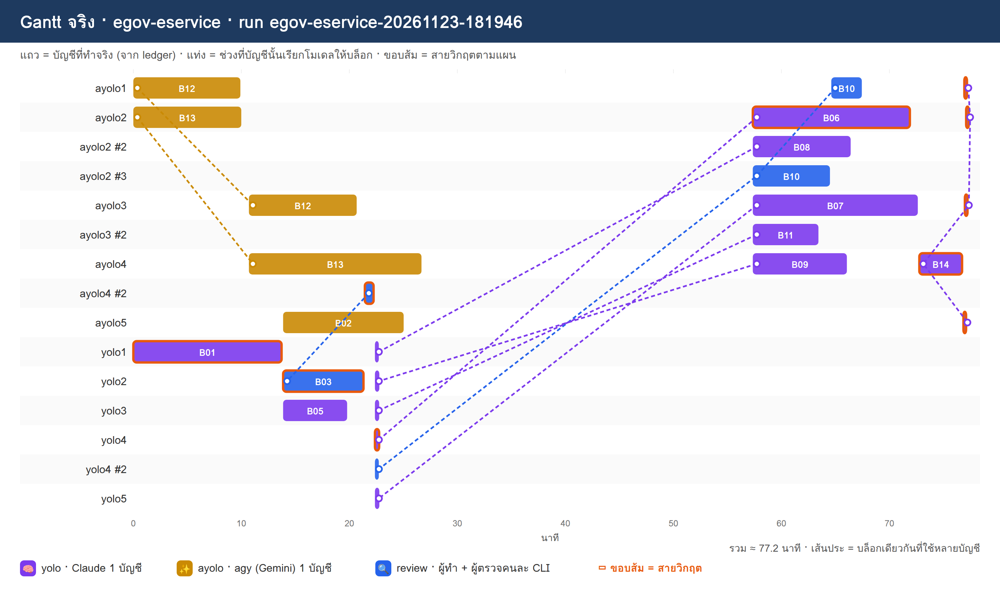
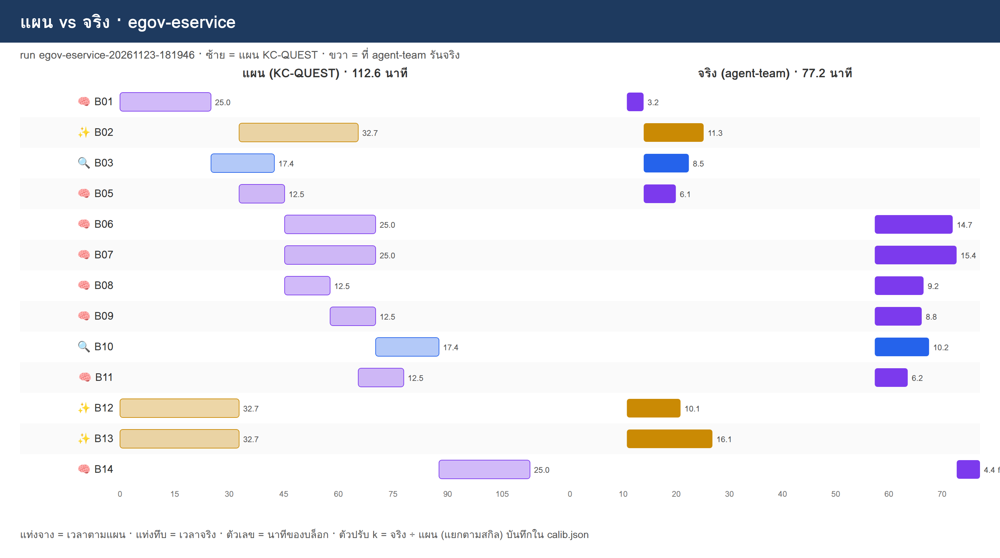

# REPORT · egov-eservice

**run:** `egov-eservice-20261123-181946` · `/workspace/.agent-team/egov-eservice-20261123-181946` · โจทย์: สร้างเว็บ e-Service กลางตามชุดโจทย์ใน /workspace/egov-brief (อ่าน README.md ก่อน) ทำตาม REQUIREMENTS.md CONTRACT.md TEST-DATA.md DECISIONS.md ครบทุกข้อ รันด้วย Docker Compose คำสั่งเดียว รองรับ TEST_MODE=1 และ BUG_MODE ตาม BUGS.md และมีชุด Playwright ครบทุก TC ใน TEST-PLAN.md · stack: Node.js 20 + Express + better-sqlite3 (DB_PATH) + หน้าเว็บ render ฝั่งเซิร์ฟเวอร์ · โมดูลอยู่ใน app/src/modules/*.js ซึ่ง server.js โหลดอัตโนมัติ · กฎตัวเลขทั้งหมดเรียกผ่าน app/src/lib/rules.js · เวลาอ่านจาก app/src/lib/clock.js เท่านั้น · บั๊ก BUG_MODE ใส่ในโมดูลที่เป็นเจ้าของกฎนั้นผ่าน isBug('Bxx') จาก app/src/lib/bugmode.js

## ตารางบล็อก (แผน vs จริง)

| บล็อก | สกิล | บัญชีแผน | บัญชีจริง | นาทีแผน | นาทีจริง | tokens (ไม่รวม cache read) | ครั้ง | สถานะ | ไฟล์ผล |
|---|---|---|---|---|---|---|---|---|---|
| **B01** | 🧠 yolo | yolo1(ทำ) | yolo1(ทำ) | 25.00 | 3.15 | 47,274 | 2 | ok | ✅ docker-compose.yml |
| B02 | ✨ ayolo | ayolo4(ทำ) | ayolo5(ทำ) | 32.73 | 11.28 | 283,766 | 1 | ok | ✅ src/seed.js |
| **B03** | 🔍 review | yolo2(ทำ), ayolo3(ตรวจ) | yolo2(ทำ), ayolo4(ตรวจ) | 17.41 | 8.50 | 315,809 | 2 | ok | ✅ src/lib/rules.js |
| B05 | 🧠 yolo | yolo3(ทำ) | yolo3(ทำ) | 12.50 | 6.05 | 156,884 | 1 | ok | ✅ src/modules/auth.js |
| **B06** | 🧠 yolo | yolo4(ทำ) | yolo4(ทำ), ayolo2(ทำ) | 25.00 | 14.67 | 550,428 | 2 | ok | ✅ src/modules/citizen.js |
| B07 | 🧠 yolo | yolo5(ทำ) | yolo5(ทำ), ayolo3(ทำ) | 25.00 | 15.40 | 583,559 | 2 | ok | ✅ src/modules/workflow.js |
| B08 | 🧠 yolo | yolo2(ทำ) | yolo1(ทำ), ayolo2(ทำ) | 12.50 | 9.18 | 454,977 | 2 | ok | ✅ src/modules/documents.js |
| B09 | 🧠 yolo | yolo3(ทำ) | yolo2(ทำ), ayolo4(ทำ) | 12.50 | 8.83 | 401,399 | 2 | ok | ✅ src/modules/notifications.js |
| B10 | 🔍 review | yolo2(ทำ), ayolo5(ตรวจ) | yolo4(ทำ), ayolo2(ทำ), ayolo1(ตรวจ) | 17.41 | 10.22 | 527,861 | 3 | ok | ✅ src/modules/dashboard.js |
| B11 | 🧠 yolo | yolo1(ทำ) | yolo3(ทำ), ayolo3(ทำ) | 12.50 | 6.20 | 381,188 | 2 | ok | ✅ src/modules/audit-admin.js |
| B12 | ✨ ayolo | ayolo1(ทำ) | ayolo1(ทำ), ayolo3(ทำ) | 32.73 | 10.10 | 355,272 | 2 | ok | ✅ e2e/part1.spec.ts |
| B13 | ✨ ayolo | ayolo2(ทำ) | ayolo2(ทำ), ayolo4(ทำ) | 32.73 | 16.10 | 370,109 | 2 | ok | ✅ e2e/part2.spec.ts |
| **B14** | 🧠 yolo | yolo3(ทำ) | ayolo4(ทำ), ayolo5(ทำ), ayolo1(ทำ), ayolo3(ทำ), ayolo2(ทำ) | 25.00 | 4.38 | 351,418 | 5 | failed — ล้มที่ ayolo2 (quota: Individual quota reached. Please upgrade your subscription to increase your limi) และไม่มีบัญชีอื่ | ❌ TEST-REPORT.md |

- tokens รวมของบล็อก **4,779,944** = ผลรวมจาก ledger ของ run (28 การเรียก) **4,779,944** ✅ ตรงกัน
- การเรียกที่ไม่ใช่บล็อก (ตรวจความพร้อม ฯลฯ): 19 ครั้ง · 0 tokens (ไม่นับในตาราง)
- เวลารวม: แผน 112.6 นาที · จริง 77.2 นาที
- บล็อกเสร็จ 12/13

## ภาพ

## ความต่างระหว่างแผนกับของจริง

- B02: แผน ayolo4(ทำ) → จริง ayolo5(ทำ)
- B03: แผน yolo2(ทำ), ayolo3(ตรวจ) → จริง yolo2(ทำ), ayolo4(ตรวจ)
- B06: แผน yolo4(ทำ) → จริง yolo4(ทำ), ayolo2(ทำ)
- B07: แผน yolo5(ทำ) → จริง yolo5(ทำ), ayolo3(ทำ)
- B08: แผน yolo2(ทำ) → จริง yolo1(ทำ), ayolo2(ทำ)
- B09: แผน yolo3(ทำ) → จริง yolo2(ทำ), ayolo4(ทำ)
- B10: แผน yolo2(ทำ), ayolo5(ตรวจ) → จริง yolo4(ทำ), ayolo2(ทำ), ayolo1(ตรวจ)
- B11: แผน yolo1(ทำ) → จริง yolo3(ทำ), ayolo3(ทำ)
- B12: แผน ayolo1(ทำ) → จริง ayolo1(ทำ), ayolo3(ทำ)
- B13: แผน ayolo2(ทำ) → จริง ayolo2(ทำ), ayolo4(ทำ)
- B14: แผน yolo3(ทำ) → จริง ayolo4(ทำ), ayolo5(ทำ), ayolo1(ทำ), ayolo3(ทำ), ayolo2(ทำ)
- (export ส่งเป็นฝั่ง yolo/cyolo ไม่ผูกบัญชี เพื่อให้ failover ของ agent-team ทำงาน → agent-team เลือกบัญชีในฝั่งเองตามโหลด/โควตา ดู references/run.md)
- event worker_switch: B14 ayolo4→ayolo5 quota: Individual quota reached. Please upgrade your subscription to increase your limi
- event worker_switch: B14 ayolo5→ayolo1 quota: Individual quota reached. Please upgrade your subscription to increase your limi
- event worker_switch: B14 ayolo1→ayolo3 quota: Individual quota reached. Please upgrade your subscription to increase your limi
- event worker_switch: B14 ayolo3→ayolo2 quota: Individual quota reached. Please upgrade your subscription to increase your limi
- event worker_switch: B14 ayolo2→ quota: Individual quota reached. Please upgrade your subscription to increase your limi

## ตัวปรับเวลา k (calib.json)

`/workspace/plans/calib.json`: {"yolo": 0.5079, "ayolo": 0.3817, "review": 0.5375}

k = นาทีจริง ÷ นาทีแผน (ก่อนคูณ k) แยกตามสกิล · `plan` ครั้งถัดไปคูณเวลาแต่ละบล็อกด้วย k ของสกิลนั้น
